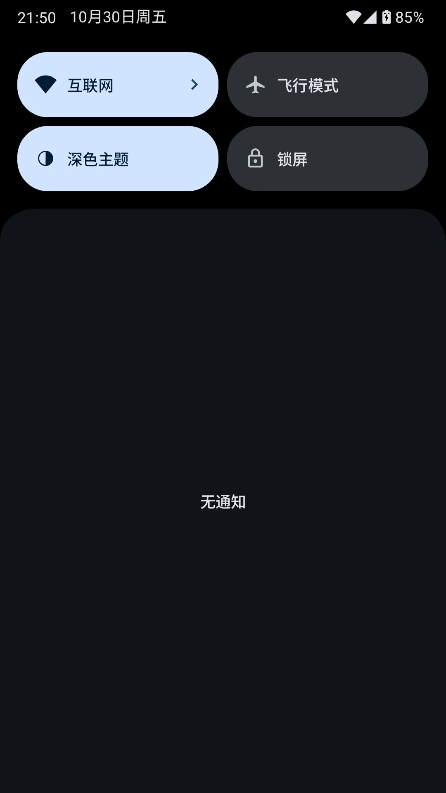
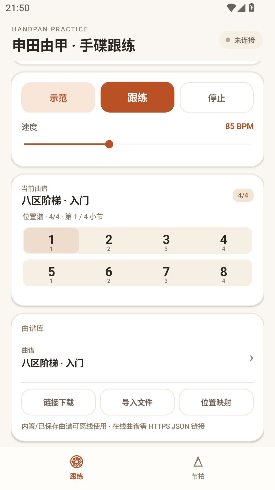
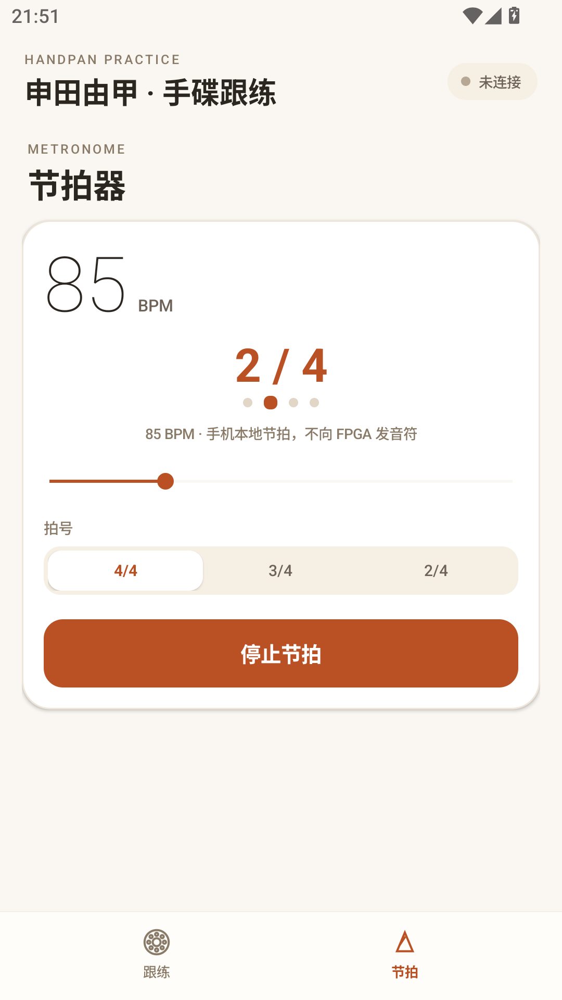
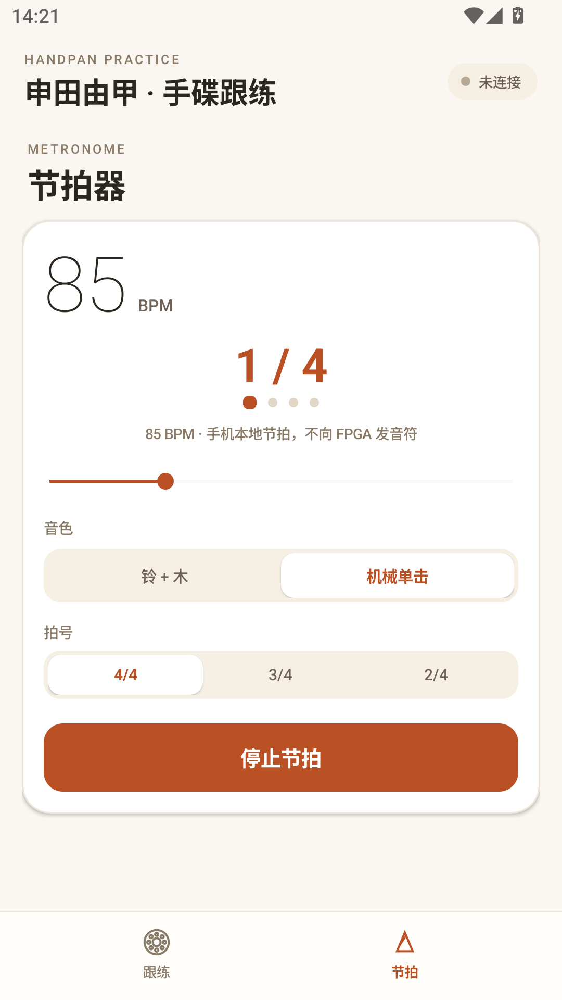
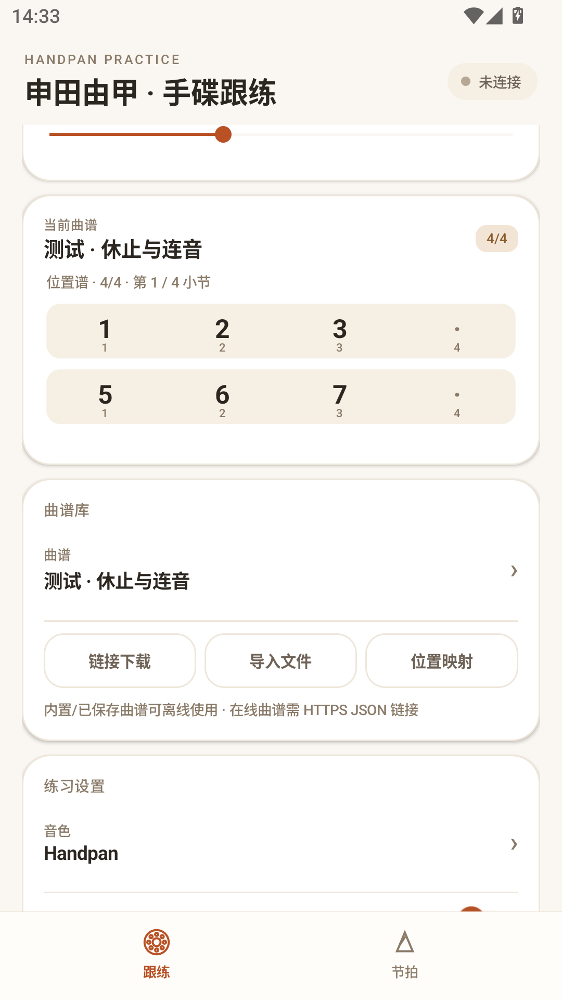
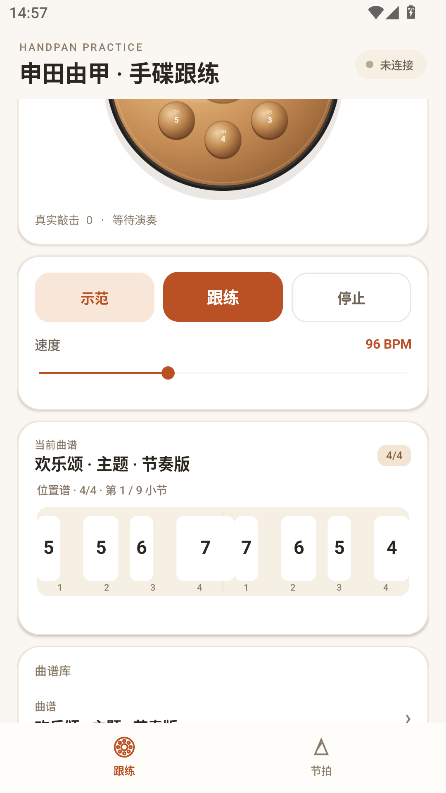

# 手碟跟练 APP · 软件说明书

版本 **v0.9（versionCode 10）**　|　包名 `cn.handpan.practice`　|　2026-11-03

---

## 1. 概述

「手碟跟练」是一款面向电子手碟（FPGA 合成器 + JDY-31 蓝牙）的练习工具。手机通过蓝牙 SPP 与手碟通信，负责曲谱示范、跟练评分、节拍器、录制回放与设备状态显示；手碟负责实时发声与敲击采集。

APP 采用暖米纸感 + 赤陶色的视觉体系，手碟音区与谱面均为自绘，适配 360–430dp 宽度的竖屏手机。

## 2. 运行环境

| 项 | 说明 |
|---|---|
| 系统 | Android 5.0（API 21）及以上 |
| 目标版本 | targetSdk 33 / compileSdk 35 |
| 权限 | 蓝牙（BLUETOOTH / BLUETOOTH_ADMIN / BLUETOOTH_CONNECT）、网络（曲谱下载） |
| 硬件 | 支持蓝牙 SPP 的 Android 手机；配对设备名 `JDY-31` |
| 安装包 | 约 257 KB，无原生库，32/64 位通用 |

## 3. 功能结构

```
手碟跟练
├── 跟练
│   ├── 连接状态 / 选择已配对设备
│   ├── 音区（8 音位触控试听 + 真实敲击反馈）
│   ├── 示范 / 跟练 / 停止 + 速度
│   ├── 当前曲谱谱面（按真实时值绘制）
│   ├── 曲谱库（12 内置 + 最多 50 首导入）
│   │   ├── 链接下载（HTTPS 直链 JSON）
│   │   ├── 导入文件（系统文件选择器）
│   │   └── 位置映射（谱位 1–8 → CH0–CH7）
│   ├── 练习设置（音色、整曲循环、回响、延音显示）
│   └── 录制与回放（真实敲击事件）
└── 节拍
    ├── BPM（40–220，滑杆）
    ├── 拍号 4/4、3/4、2/4
    ├── 音色：铃 + 木 / 机械单击（两套真实录音）
    └── 拍点指示 / 启动·停止
```

## 4. 界面与操作

### 4.1 跟练页

- **连接**：点右上「连接」，选择已配对的 `JDY-31`；状态胶囊显示未连接 / 连接中 / 已连接 / 数据延迟。
- **音区**：8 个音位对应 CH0–CH7，点击发送试听音符（力度 100，不计命中）；真实敲击时对应音位青绿高亮并显示力度、Peak、命中、丢包。
- **示范 / 跟练 / 停止**：连接后可用。示范按谱面时间发送音符；跟练接收真实敲击并按 ±250 ms 判定命中；停止立即结束。
- **速度**：40–200 BPM；选中曲谱时自动设为该曲 BPM，手动调整后从当前位置重新开始。
- **谱面**：横向为拍位，块宽为音符时值，空白为休止/间隔；播放头随节拍移动。
- **曲谱库**：点曲谱行选择；「链接下载」需 HTTPS 直链 JSON；「导入文件」从系统文件选择器导入；「位置映射」可把谱位重指到任意 CH。
- **练习设置**：音色（Handpan / Pluck / Marimba / Drum）、整曲循环、回响 ON/OFF、延音（QSU1 遥测）。
- **录制与回放**：录制真实敲击（最多 5 分钟 / 4096 事件），保存为 `last_take.json`；回放按原时间间隔重新发送音符。

### 4.2 节拍页

- 速度 40–220 BPM，滑杆实时生效；
- 拍号切换会停止节拍并同步按钮文案；
- 音色两套：**铃 + 木**（重拍塑料铃、弱拍木节拍器）与 **机械单击**（真实机械节拍器）；选择写入偏好，重启保留；
- 拍点圆点随拍号变化，当前拍放大变赤陶；
- 启动 / 停止按钮随状态切换。

## 5. 曲谱格式

支持两种 JSON，导入时自动识别。

### 5.1 version 1（旧）

```json
{"version":1,"beats_per_bar":4,"title":"…","positions":[1,2,3,0,5,6,7,0]}
```

- 每拍一个音，`0` 为休止；长度 4–512 拍、4 的倍数；默认 85 BPM。

### 5.2 version 2（推荐）

```json
{
  "version": 2,
  "beats_per_bar": 4,
  "title": "欢乐颂 · 五线谱版",
  "bpm": 96,
  "notes": [
    {"b": 0.0,  "d": 1.5, "p": 8, "v": 110},
    {"b": 1.5,  "d": 0.5, "p": 7, "v": 98}
  ]
}
```

| 字段 | 含义 |
|---|---|
| `bpm` | 该曲速度（40–200），选中后同步速度滑杆 |
| `b` | 音符起点（拍，可小数） |
| `d` | 音符时值（拍） |
| `p` | 音位 1–8；`0` 为休止 |
| `v` | 力度 1–127（可选，默认 100） |

约束：4/4、4–512 个音符、`b` 升序、`d` 0–16 拍。

### 5.3 导入方式

- **文件**：曲谱库 → 导入文件 → 选择 JSON；
- **链接**：曲谱库 → 链接下载 → 输入 HTTPS 直链（不跟随跳转、≤64 KB、仅 https）；
- 同名曲谱会被拒绝；外部曲谱最多 50 首，保存在应用私有目录 `scores.json`。

## 6. 技术实现

### 6.1 蓝牙与协议

- SPP UUID `00001101-0000-1000-8000-00805F9B34FB`；
- 帧格式：4 字节 magic + 版本/类型/长度 + payload + CRC16（CCITT 0x1021）；
- 支持帧：`QSU1`（30 B，延音/错误计数）、`HTE1`（28 B，真实敲击）、`PMR1`（88 B，窗口统计）、`QKY1`（34 B，按键链）；
- 音符帧 `F9`：5 字节频率码 + 力度 + 音色 + 异或校验；
- 发送使用单线程队列，接收解析在 IO 线程，UI 回调切主线程。

### 6.2 曲谱调度

- 25 ms tick，按 `beatPos = (now - start) / beatMs` 推进；
- 到达 `note.start` 才发送，空档不发送；迟到 >0.35 拍的音符跳过，避免补发爆发；
- 跟练评分找“最近一个未命中、音位匹配、起点在 ±250 ms 内”的音符；
- 循环时按 `song.length` 重置。

### 6.3 音频

- 节拍器：`SoundPool` 预加载 `res/raw` 三段 WAV（44.1 kHz / 单声道 / 16-bit），重拍/弱拍分别播放；样本未就绪时回退 `ToneGenerator`；
- 曲谱示范：经蓝牙发送到 FPGA 发声，APP 不合成乐器音色；
- 回响：`FA` 控制帧（ON `FA 6A 3F` / OFF `FA 2A 7F`）。

### 6.4 界面

- 单 `Activity` + 代码构建视图（无 XML 布局），便于在无资源编辑器的环境中维护；
- 自绘 `Pad`（手碟铜面、8 音位、敲击涟漪）与 `ScoreView`（按时值绘制音符块、播放头）；
- 设计 Token 固定为：暖米 `#FAF7F2`、赤陶 `#B95125`、墨 `#2B2620`、铜 `#C08A52`。

## 6.5 运行截图

| 跟练页 | 曲谱与设置 |
|---|---|
|  |  |

| 节拍器 | 节拍器音色 |
|---|---|
|  |  |

| 休止谱面 | 节奏谱面 |
|---|---|
|  |  |

## 7. 测试记录

环境：MuMu 模拟器 Android 15，1080×1920 @420dpi；APP v0.9。

| 项目 | 结果 |
|---|---|
| 全新安装 / 从 v0.4 覆盖升级（同证书） | 通过 |
| 启动、底部双 Tab 切换 | 通过 |
| 节拍器：两套音色、切换、重启记忆 | 通过 |
| 节拍器：运行中切拍号 → 停止并显示「启动节拍」 | 通过 |
| 节拍器：运行中切音色 → 停止并同步按钮 | 通过 |
| 曲谱：v1 / v2 导入与加载 | 通过 |
| 曲谱：选中后 BPM 同步（96 BPM） | 通过 |
| 谱面：不同时值块宽、休止、播放头 | 通过 |
| 曲谱：连续同音高亮闪两次（v0.6 修复） | 通过（逻辑） |
| 崩溃检查 `logcat -s AndroidRuntime:E` | 无 FATAL |
| 实体蓝牙链路（JDY-31 / QSU1 / HTE1） | 未联调（无硬件） |

## 8. 已知限制

1. **单个音符的音频尾长不可控**：FPGA 固件没有 note-off / gate-off，release 分支不可达；延音由中央滑环全局控制，手机不下发延音。APP 的 `d` 用于谱面显示、调度与留白，声音尾长仍由固件决定。若需真正“短音变短”，需固件增加停音命令（例如 `F9` velocity=0，或新增 `FA` 停音）。
2. 仅支持 **4/4**；3/4、6/8 曲目会被迫改写，故未收录。
3. 曲谱库没有删除入口；同名不可覆盖，需换标题导入。
4. 未适配深色模式与横屏/平板。
5. 安装包为开发证书签名，正式发布需更换。

## 9. 版本记录

| 版本 | 内容 |
|---|---|
| 0.4 | 曲谱库、HTTPS 下载、文件导入、位置映射（基线） |
| 0.5 | 界面整体重做：暖米/赤陶、卡片、手碟自绘、底部双 Tab、品牌图标 |
| 0.5.1 | 修复签名不一致导致无法覆盖安装；蓝牙/音频兼容加固 |
| 0.6 | 节拍器两套真实音色（SoundPool）；修复切拍号按钮文案；连续同音闪烁 |
| 0.7 | 曲谱支持 `0=休止`；切换音色停止并同步按钮 |
| 0.8 | 演示/跟练时序重写：v2 曲谱自带 BPM、每音起点/时值/间隔 |
| 0.9 | 每音力度 `v`；按五线谱重写示例曲谱（欢乐颂、好国王温塞斯拉斯） |

## 10. 文件说明

| 文件 | 作用 |
|---|---|
| `MainActivity.java` | 界面、蓝牙、练习调度、节拍器、录音回放、曲谱库 |
| `Song.java` | 曲谱模型与 v1/v2 解析/序列化、每音力度 |
| `Protocol.java` | 帧解析、CRC、音符帧 |
| `PositionMap.java` | 谱位到 CH 的映射校验 |
| `PracticeSongs.java` | 12 首内置曲谱 |
| `res/raw/*.wav` | 节拍器音色（CC0 录音） |
| `res/mipmap-*/ic_launcher.png` | 启动图标 |
